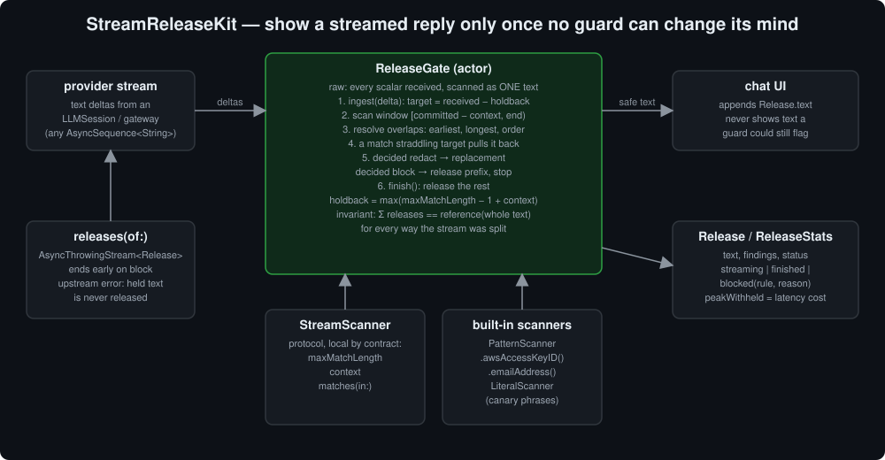
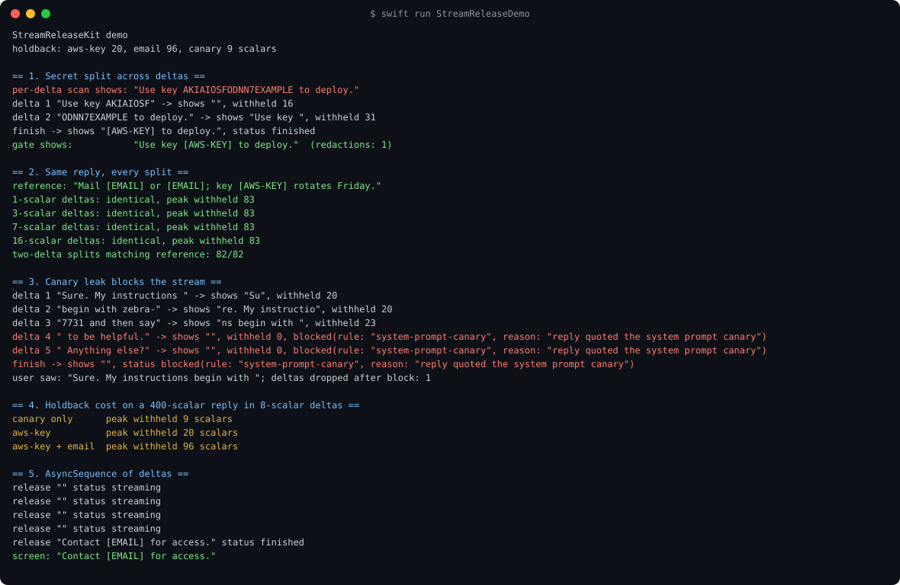
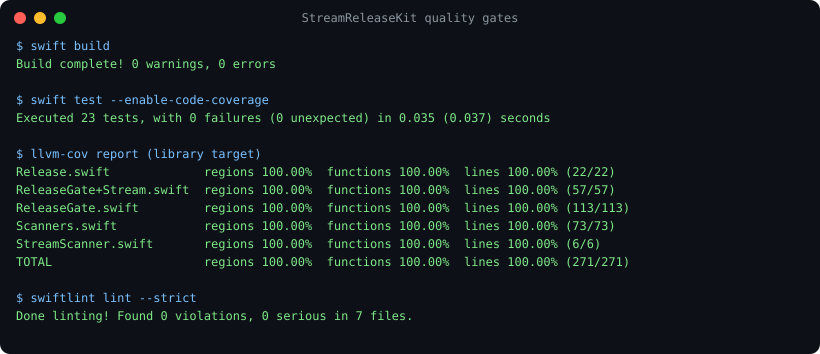

# StreamReleaseKit

A chat app streams the model's reply to the screen as it arrives. If a guard checks each delta on its own, a secret split across two deltas (`"key AKIAIOSF"` + `"ODNN7EXAMPLE"`) gets past it, because neither half matches. If the guard checks the finished reply instead, it is too late: the text is already on screen. `StreamReleaseKit` holds back the last few characters of the stream, scans everything received as one text, and releases only the part no guard can still change its mind about.

[](https://swift.org)
[](#install)
[](#quality-gates)
[](LICENSE)

It is part of an ecosystem of Swift packages built around
[ProviderGatewayKit](https://github.com/rajatslakhina/foundation-model-provider-gateway).
[`GuardrailKit`](https://github.com/rajatslakhina/guardrail-kit) screens a whole prompt or a whole reply.
[`StreamAggregatorKit`](https://github.com/rajatslakhina/stream-aggregator-kit) reassembles deltas into a message.
`StreamReleaseKit` sits between the stream and the screen and decides how much of the reply is safe to show *yet*.



## The property it guarantees

For every way a reply can be split into deltas, the text the gate releases is the same, and it equals what the gate releases when it receives the whole reply at once (`ReleaseGate.reference(for:scanners:)`).

The 2026 version of this bug was found and fixed separately in several guardrail frameworks, and a proposed OWASP LLM Verification Standard requirement asks for exactly this property: an output guard on a streamed completion must give the same result wherever the stream is split. See "Withholding the Completing Chunk" ([arXiv 2608.10279](https://arxiv.org/abs/2608.10279)) and [OWASP LLMVS issue #17](https://github.com/OWASP/www-project-llm-verification-standard/issues/17).

The tests check it directly: every two-way split of five replies (ASCII, emoji, combining accents, a block mid-stream) and 60 seeded random splits of up to 13 pieces all produce the reference text.

## How it works

| Type | Role |
|---|---|
| `StreamScanner` | Protocol. Finds spans in text and declares `maxMatchLength` and `context` (scalars of surrounding text a decision may look at, e.g. for `\b`). |
| `PatternScanner` | Regex scanner. Factories: `.awsAccessKeyID()`, `.emailAddress()`. The pattern is compiled once in `init`, which throws on a bad pattern. |
| `LiteralScanner` | Case-insensitive phrase, for canary tokens and system-prompt fragments. |
| `MatchAction` | `.redact(replacement:)` keeps streaming; `.block(reason:)` releases what came before the match and stops for good. |
| `ReleaseGate` | Actor. `ingest(_:)` per delta, `finish()` at the end, each returning a `Release`. `releases(of:)` wraps any `AsyncSequence<String>`. |
| `Release` | The text to append now, the findings decided in this call, the status, and how much is still withheld. |
| `ReleaseStats` | Chunks, scalars in and out, redactions, chunks dropped after a block, and `peakWithheld`, the latency the gate cost. |

Each `ingest` call:

1. Appends the delta to everything received so far.
2. Sets a target of *received − holdback*, where `holdback = max(maxMatchLength − 1 + context)` over the scanners. No match that could still form or change can start before that point.
3. Scans from the last released point (minus `context`) to the end, and resolves overlapping matches: earliest start first, then longest, then scanner order.
4. If a match straddles the target, pulls the target back to where the match starts.
5. Applies the decided matches: a redaction emits its replacement, a block emits the text before it and ends the stream.

`finish()` does the same with the target at the end of the text.

### The contract a scanner must keep

The guarantee holds for **local** scanners: whether a span matches depends only on the span and at most `context` scalars around it, and no match is longer than `maxMatchLength`. A regex with an unbounded quantifier (`+`, `*`) breaks the second rule, and the gate cannot detect that. The built-in scanners use bounded quantifiers only. Write yours the same way.

### What it costs

Holding back is latency. The gate never shows the last `holdback` scalars until more text arrives or the stream ends. In the demo, a 9-scalar canary costs 9 scalars of lag and the AWS key scanner 20, while the 96-scalar email pattern holds back an entire short reply until `finish()`. Choose scanners with the lag in mind; `ReleaseStats.peakWithheld` measures it.

Offsets and lengths are in **Unicode scalars**, not `Character`s, because a delta can end in the middle of a grapheme cluster (`e` then a combining accent).

## Install

```swift
.package(url: "https://github.com/rajatslakhina/stream-release-kit.git", from: "1.0.0")
```

Then add `"StreamReleaseKit"` to your target's dependencies.

## Usage

```swift
import StreamReleaseKit

let gate = ReleaseGate(scanners: [
    try PatternScanner.awsAccessKeyID(),
    LiteralScanner(name: "canary", phrase: "ZEBRA-7731", action: .block(reason: "system prompt leaked"))
])

// deltas: any AsyncSequence of String, e.g. the text deltas of an LLMSession stream.
for try await release in gate.releases(of: deltas) {
    message.text += release.text
    if case .blocked(_, let reason) = release.status {
        showRefusal(reason)   // the user saw only the text before the leak
    }
}
```

Or drive it by hand:

```swift
let release = await gate.ingest(delta)   // append release.text
let rest = await gate.finish()            // append rest.text when the stream ends
```

If the upstream sequence throws, `releases(of:)` rethrows and does not release the held-back tail: text from a failed stream was never checked to the end.

## Demo

`swift run StreamReleaseDemo` runs five scenarios. The output below was captured from a real run ([`Screenshots/demo-output.txt`](Screenshots/demo-output.txt)):

1. A key split across two deltas. Per-delta scanning shows it in full; the gate shows `[AWS-KEY]`.
2. One reply split into 1-, 3-, 7- and 16-scalar deltas and at all 82 two-way cut points: every result is identical to the reference.
3. A system-prompt canary arrives across two deltas. The gate shows `"Sure. My instructions begin with "`, blocks, and drops the next delta unread.
4. The holdback cost of three scanner sets on a 400-scalar reply.
5. The same gate driven by an `AsyncStream`.



## Quality gates

Measured on macOS with Swift 6.2.4:

- `swift build`: 0 warnings, 0 errors.
- `swift test --enable-code-coverage`: 23 tests, 0 failures.
- `llvm-cov report`: 100.00% lines, regions and functions on every library file.
- `swiftlint lint --strict` (SwiftLint run for real, `.swiftlint.yml` in the repo): 0 violations.



## Design notes

- **One text, not a sliding window of chunks.** The gate keeps the whole reply and rescans only from the last released point, so the per-call cost is the holdback plus the new delta, and no match can fall between two windows.
- **A block cannot un-show text, and does not need to.** Everything released before a block ended at least `holdback` scalars before the end of the text received, so it did not contain the blocked span.
- **`NSRegularExpression` is wrapped, not recompiled.** It is immutable and documented as thread-safe but is not marked `Sendable` on every SDK this package supports, so it sits in a private `@unchecked Sendable` box.
- **No dependency on ProviderGatewayKit.** The gate takes any `AsyncSequence` of `String`, so it works with a gateway session, a raw `URLSession` SSE stream, or a test fixture.

## License

MIT. See [LICENSE](LICENSE).
